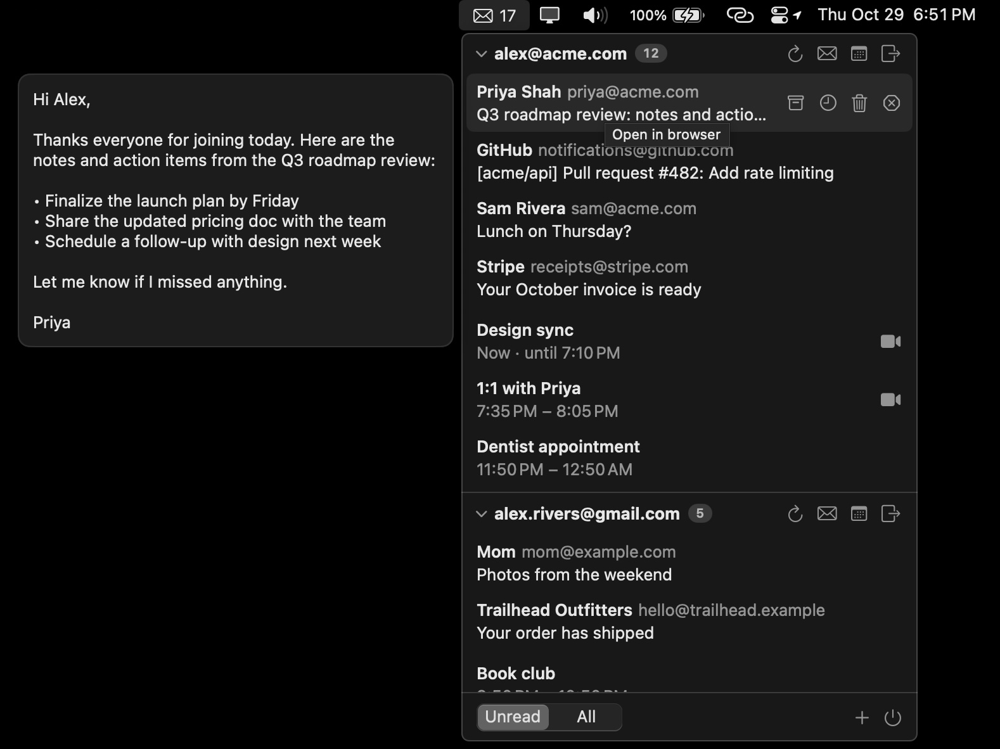

# Mail Menu

A macOS menu bar app to track unread email and upcoming calendar events.

Currently: sign in with one or more Google accounts to see:

- **Unread mail** in your Gmail inboxes, with the total count in the menu bar. Switch the footer selector to **All** to see the first 20 messages of the inbox, read or not. Click a message to open it in Gmail, or hover it to archive it or unsubscribe from its mailing list (or, for other mail, block the sender and report spam). Click an account to collapse or expand it.
- **Upcoming events** in the next 24 hours from your Google Calendars. Events already in progress are included. Click an event to join its video call (Google Meet, Zoom, Teams, …) or open it in Google Calendar, or hover it and use the calendar button to open it in Google Calendar.



## Prerequisites

- macOS 14+ and Xcode 16+.
- A Google OAuth client. There's no prebuilt download yet, so you build Mail Menu with your own client:

  1. Go to the [Google Cloud console](https://console.cloud.google.com/) and create a project (e.g. "Mail Menu").
  2. Enable the [Gmail API](https://console.cloud.google.com/apis/library/gmail.googleapis.com) and the [Google Calendar API](https://console.cloud.google.com/apis/library/calendar-json.googleapis.com) for the project.
  3. Open [Google Auth Platform](https://console.cloud.google.com/auth/overview) and click **Get started**:
     - App name: `Mail Menu`, plus your email as the support email.
     - Audience: **External**.
  4. Under **Audience → Test users**, add the Google account(s) you want to sign in with.
  5. Under **Data Access**, add the scopes `https://www.googleapis.com/auth/gmail.modify`, `https://www.googleapis.com/auth/gmail.settings.basic` and `https://www.googleapis.com/auth/calendar.events.readonly`.
  6. Under **Clients**, click **Create client**:
     - Application type: **iOS** (Google uses iOS clients for macOS apps; they need no client secret)
     - Bundle ID: `app.mailmenu.MailMenu`
  7. Copy the client ID (it looks like `1234567890-abc…xyz.apps.googleusercontent.com`).

## Install

1. Clone the repository:

   ```sh
   git clone https://github.com/aakashns/mailmenu.git
   cd mailmenu
   ```

2. Create `app/Config/Local.xcconfig` and set `GOOGLE_CLIENT_ID` to your client ID:

   ```sh
   cp app/Config/Local.xcconfig.example app/Config/Local.xcconfig
   # edit app/Config/Local.xcconfig and set GOOGLE_CLIENT_ID
   ```

3. Build and install:

   ```sh
   scripts/install.sh
   ```

   This builds a release copy, installs it to `/Applications/MailMenu.app` and launches it. An envelope icon appears in the menu bar. Click it, then click **Continue with Google**.

4. To start Mail Menu when you log in, open **System Settings → General → Login Items**, click **+** under "Open at Login" and choose **MailMenu**.

To update, pull the latest changes and run `scripts/install.sh` again. It quits the running copy before replacing it. To uninstall, quit Mail Menu and delete `/Applications/MailMenu.app`. Your sign-in stays in the Keychain under `app.mailmenu.MailMenu` until you delete it in Keychain Access.

To install somewhere else, set `INSTALL_DIR`, e.g. `INSTALL_DIR=~/Applications scripts/install.sh`.

## Repository layout

```
app/        macOS app (SwiftUI, Xcode project)
  Config/   build settings, Info.plist, entitlements
  MailMenu/ Swift sources
scripts/    install script
```

## Development setup

Complete the [prerequisites](#prerequisites), clone the repository and create `app/Config/Local.xcconfig` as described in [Install](#install). Then open the project in Xcode:

```sh
open app/MailMenu.xcodeproj
```

Press **⌘R** in Xcode. An envelope icon appears in the menu bar (there's no Dock icon). Click it, then click **Continue with Google**.

To build and run from the terminal instead, run this from the repository root:

```sh
xcodebuild -project app/MailMenu.xcodeproj -scheme MailMenu -configuration Debug -derivedDataPath app/build -quiet \
  && { pkill -x MailMenu; open app/build/Build/Products/Debug/MailMenu.app; }
```

The command quits any running copy of the app before opening the new build. If the build fails, the old copy keeps running.

If you've also installed Mail Menu with `scripts/install.sh`, quit the installed copy while developing, or you'll see two menu bar icons.

### Things to know

- **Google warns that the app isn't verified.** That's expected while the Google Cloud app is in Testing mode. Click **Continue**.
- **You'll be signed out after 7 days.** Google expires refresh tokens after 7 days for apps in Testing mode. Sign in again when it happens.
- **macOS asks for Keychain access after each rebuild.** The default ad-hoc signature changes with every build. To avoid the prompt, set `DEVELOPMENT_TEAM` in `Local.xcconfig` (a free Apple ID personal team works).

## How it works

- **Sign-in** uses OAuth 2.0 for native apps (authorization code + PKCE) through `ASWebAuthenticationSession`. The refresh token is stored in the macOS Keychain. Nothing leaves your Mac except requests to Google.
- **Mail** is read and changed through the Gmail REST API with the `gmail.modify` scope. The app lists messages labeled both `INBOX` and `UNREAD`. Archiving removes the conversation from the inbox. Blocking reports the conversation as spam and, using the `gmail.settings.basic` scope, adds a Gmail filter that sends future mail from that sender to the trash. You can find and remove these filters in Gmail under Settings > Filters and Blocked Addresses. Unsubscribing uses the message's `List-Unsubscribe` header: senders that support one-click unsubscribe (RFC 8058) are unsubscribed directly and the conversation is archived; otherwise the app opens the sender's unsubscribe page, or a prefilled unsubscribe email in Gmail.
- **Events** are read through the Google Calendar API with the read-only `calendar.events.readonly` scope. The app shows timed events from your primary calendar, and skips all-day events, declined invitations and working location entries.
- Everything refreshes every 2 minutes, and whenever you open the menu.

## License

[MIT](LICENSE)
